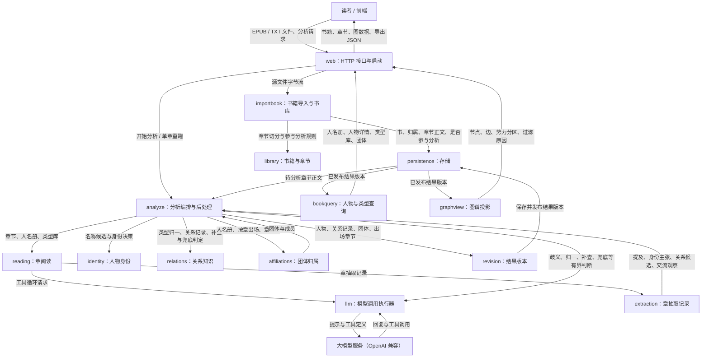

# ZhiYing 架构总览

## 项目说明

ZhiYing 面向想读中长篇小说、但被人物和称呼绕晕的读者：上传一本 EPUB 或 TXT，系统自动认人、判断人物关系并生成可过滤、可解释的关系图，用户不需要人工校对。

系统由两部分组成：Kotlin 后端 `zhiying_backend/`（模块化单体）负责书籍导入、调用大模型逐章分析、汇总人物与关系、按结果版本发布，并通过 HTTP 提供给 React 前端 `frontend/`；前端负责书架、关系图浏览与分析进度展示。本文主要写后端，前端见末尾「前端」一节。产品范围见 [PRD](./PRD.md)，领域模型与分析流程细节见 [DESIGN](./DESIGN.md)，待办见 [todo](./todo.md)。

## 数据流

上传先在任务登记锁内按源文件 SHA-256、当前导入与方法版本、整书完整标记判定秒传；命中仅新增书架条目，未命中才拆成章节并保存新书和条目。共享书的分析或清空先分叉，首次发布再原子切换条目；分析编排逐章交给章阅读（大模型多轮工具循环）得到章抽取记录，再由后处理规则在全书范围内完成身份对齐、类型归一、有限补查与软关系兜底，组装成一套一致的结果版本并发布；全书读完后再做团体归纳；出图与人物 / 类型 / 团体查询只读已发布版本。

## 核心子系统与职责

分层规则：编译依赖为 `web → application → domain`、`infrastructure → application → domain`，`web` 只在运行时装配 `infrastructure`；`domain` 只做纯计算，不依赖框架、网络、文件、数据库。外部能力接口定义在使用它的应用层业务包内，由基础设施实现。编码约束见根目录 `AGENTS.md`。

基础约定：
- **错误码**：对外错误统一登记在 `application` 的 `ErrorCode`，用例拒绝请求时抛 `AppException(code)`；`web` 的 `ApiExceptionHandler` 是错误码到 HTTP 状态的唯一映射，响应为带 `code` 字段的 ProblemDetail。模型调用的执行失败（`ModelFailure`）是业务结果，不是错误码。
- **配置**：项目自有可调参数统一放在 `zhiying.*`，由 `infrastructure` 的 `ZhiYingProperties` 类型化绑定并在启动时校验，不使用散落的 `@Value`；应用层需要的参数由基础设施组装成应用层自己的设置对象注入。例外是后台可改的项：用量上限、提示词与各环节模型存于 `app_settings`，服务商存于 `model_providers`（密钥加密），见 DESIGN §5.7。
- **不建 common 模块**：值对象放 `domain`，错误码放 `application`，技术工具放 `infrastructure`。

### web · HTTP 接口与启动

- **覆盖范围**：`com/zhiying/web`、`com/zhiying/ZhiYingApplication`。
- **职责**：Spring Boot 启动与依赖装配、路由、请求 / 响应 DTO、错误映射；账号注册、登录 / 退出、管理员邀请码与密码重置接口。请求边界读取会话 Cookie、传递当前账号、设置或清除 Cookie，非安全方法检查 CSRF 请求头；书籍与任务权限由应用层判定。本人额度接口 `GET /api/me/usage` 仅返回书数和字数；管理员用量、模型覆盖接口沿用现有角色校验，书列表 / 详情、任务快照与 SSE 的 token 字段只向管理员输出。书籍上传、查询、删除与清空分析，分析启动 / 取消 / 单章重跑、任务快照、进度推送（SSE）、章抽取结果、图与导出、人名册与人物详情、关系类型、团体、模型诊断接口。
- **对应位置**：`web/`（`com.zhiying.web.books`、`web.analysis`、`web.graph`、`web.cast`、`web.types`、`web.factions`、`web.diagnostics`、`web.error`）。

[探索这个子系统](#module=com/zhiying/web)

### 账号与访问控制

- **依据**：产品权限见 PRD §5.11–5.12，表结构、事务和会话安全细节见 DESIGN §5.5。
- **domain**：账号身份、角色及用户名 / 密码格式规则属于领域；不读取 Cookie、不执行密码算法、不访问数据库。
- **application**：编排注册、登录、退出、邀请码创建、密码重置及首次管理员引导，生成随机会话 token；定义所需存储与密码算法接口。先查会话身份、书主或已发布示例，再执行查询或操作；章、任务、SSE 与导出入口都沿关联书检查权限。管理员角色仅增加维护能力，不授予他人私有书权限。
- **infrastructure**：实现 SQLite 账号、邀请码、会话与书主存储，以及 JDK 密码派生与会话哈希；配置通过 `ZhiYingProperties` 绑定并装配应用层设置。管理员引导保留已有数据，只补齐无主书的归属。
- **web / frontend**：web 处理 HTTP 会话与 CSRF 边界；前端提供登录、邀请码注册、退出；管理员入口统一为 `/admin` 的用量、模型、评测、账号与反馈页签，旧 `/eval` 跳转后台，按角色展示维护操作。前端与 API 使用同一站点，不开放 CORS；部署命令见 README。
- **对应位置**：`domain/…/account`、`application/…/account`、`application/…/library/BookAccess.kt`、`infrastructure/…/persistence/account`、`infrastructure/…/config/AccountConfiguration.kt`。

### quota · 用量上限

- **依据**：产品规则见 PRD §5.13，配置与计量见 DESIGN §5.6。
- **domain**：`QuotaLimits` 与 `UsageSnapshot` 保存上限和快照，上传与分析检查返回 sealed `QuotaCheck`，纯计算，不访问存储。
- **application**：`QuotaUsage` 读取本人用量、转换领域拒绝结果为已登记错误码；上传在任务登记锁内检查文件大小、本人重复与新增书数；分析在任务登记锁内提前判定复用、检查全站预算与本人额度、预占字数再启动线程，结束后结算。`UsageLedger` 是本用例使用的存储接口。
- **infrastructure**：`zhiying.quota.*` 由 `ZhiYingProperties` 绑定，`QuotaConfiguration` 校验 multipart 上限；SQLite 流水每任务一行，不对书建外键，删除书和清空分析不删除；首次读取标记支持服务重启结算，启动补齐已有数据库的标记列。
- **web / frontend**：`/api/me/usage` 仅返回当前登录账号的书数和字数，书架顶部显示启用额度，直接展示后端超限提示。
- **对应位置**：`domain/…/quota`、`application/…/quota`、`infrastructure/…/persistence/quota`、`infrastructure/…/config/QuotaConfiguration.kt`、`web/…/account/UsageController.kt`。

### feedback · 用户反馈

- **依据**：产品规则见 PRD §5.16，模型与接口见 DESIGN §5.8。
- **domain**：`Feedback` 保存不可变提交快照并校验对象引用、范围、关系键和说明长度，不改变分析结果。
- **application**：`Feedbacks` 确认登录、条目读权限与真实结果版本后保存；管理员仅查看和导出反馈，私人书不加载结果、不放开读权限。
- **infrastructure**：`SqliteFeedbackStore` 追加并读取独立 `feedback` 表；保存书名和对象名称，删除书或清空结果不级联删除反馈。
- **web / frontend**：两个提交入口成功返回 204；管理员列表与 JSONL 导出仅管理员可用。人物、关系、势力和通用反馈共用表单；管理页面接入 `/admin?tab=feedback`。
- **对应位置**：`domain/…/feedback`、`application/…/feedback`、`infrastructure/…/persistence/feedback`、`web/…/feedback`、`frontend/src/feedback`、`frontend/src/admin/FeedbackPanel.tsx`。

### importbook · 书籍导入与书库

- **覆盖范围**：`com/zhiying/application/importbook`、`com/zhiying/application/library`、`com/zhiying/application/removal`、`com/zhiying/infrastructure/epub`、`com/zhiying/infrastructure/txt`。
- **职责**：解析 EPUB（阅读顺序、目录标题、正文清洗、按标题或章节标记切章）与 TXT（编码识别、按预置分章方案自动切章，可预览改选，DESIGN §5.9），判定每章是否参与分析并给出原因；上传用例在导入之前判定秒传，命中只新增条目，未命中在同一事务保存新书、条目与正文。`ShelfItems` 在应用层解析结果与任务书；`ForkBook` 对共享书写操作重新导入并复制当前抽取，清空时不复制。删除条目仅回收无当前或 pending 引用的书与源文件，模型任务运行时拒绝删除和清空。
- **对应位置**：`application/…/importbook`、`application/…/library`、`application/…/removal`、`infrastructure/…/epub`、`infrastructure/…/txt`。

[探索这个子系统](#module=com/zhiying/application/importbook)

### analyze · 分析编排与后处理

- **覆盖范围**：`com/zhiying/application/analyze`、`com/zhiying/infrastructure/llm/analysis`、`com/zhiying/infrastructure/persistence/analysis`。
- **职责**：整书分析与单章重跑（`run`）：章节切成阅读单元按阅读顺序进并发池，首单元暖启动，每单元完成后做确定性身份对齐更新人名册快照；同书同时只允许一个任务，支持取消、SSE 进度、复用未失效的章抽取，有章失败时不发布。读完后由 `AnalysisPostProcessorFactory` 创建的 `AnalysisPostProcessor` 依次做身份对齐、类型归一、关系记录构建、有限补查、软兜底并组装结果版本，四个模型判断端口由 `infrastructure.llm.analysis` 实现，类型语义决策缓存在 SQLite；最后团体归纳并发布。
- **对应位置**：`application/…/analyze`（`run`、`identity`、`relations` 子包）、`infrastructure/…/llm/analysis`、`infrastructure/…/persistence/analysis`。

[探索这个子系统](#module=com/zhiying/application/analyze)

### reading · 章阅读

- **覆盖范围**：`com/zhiying/application/analyze/reading`、`com/zhiying/infrastructure/llm/reading`。
- **职责**：端口 `ChapterReader` 把一章正文读成章抽取记录：章阅读 Agent 在本章会话内按需读正文、搜索、查人名册、登记人物与别名、提交关系与交流观察；长章按段读取时只负责本段，搜索与取证覆盖整章。工具在边界校验人物编号、类型与引文并把结构化错误返回给模型修正。
- **对应位置**：`application/…/analyze/reading`、`infrastructure/…/llm/reading`。

[探索这个子系统](#module=com/zhiying/infrastructure/llm/reading)

### llm · 模型调用执行器

- **覆盖范围**：`com/zhiying/infrastructure/llm`、`com/zhiying/application/llm`。
- **职责**：通过 Spring AI 以 OpenAI 兼容协议调用模型；提供单次请求入口（并发、预算、取消、重试退避、用量统计、失败归类）、结构化调用执行器（解析失败自动重答）与工具循环执行器；应用层用 `ModelCallControl` 传入预算、取消信号与任务启动时固定的 `ModelSnapshot`。`ModelSettings` 读取后台覆盖与部署缺省，读章、后处理、团体归纳按快照传入请求级模型 / thinking options；发布方法版本按任务快照计算，秒传按当前生效配置计算。也包含模型连通性探针。
- **对应位置**：`infrastructure/…/llm`、`application/…/llm`。

[探索这个子系统](#module=com/zhiying/infrastructure/llm)

### persistence · 存储

- **职责**：SQLite 数据源与建表脚本（`resources/schema/*.sql`，启动时执行）；账号、邀请码、会话与书主关联的持久化（DESIGN §5.5）；书与章节（`library`）、结果版本与发布指针（`revision`）的存储，源 EPUB 按内容摘要存文件。章抽取记录（按章存 JSON，重跑产生新记录，当前指针指向最新）、分析任务与各章进度、书的分析状态存储在 `persistence.analysis`；独立用量流水位于 `persistence.quota`，任务预占与登记同一事务，结束或重启结算。
- **对应位置**：`infrastructure/…/persistence`。

[探索这个子系统](#module=com/zhiying/infrastructure/persistence)

### diagnostics · 模型诊断

- **职责**：仅管理员可指定服务商、模型名与思考开关，检查模型服务能否完成对话、工具调用与结构化输出；后台复用原诊断接口，报告不返回服务地址或密钥。
- **对应位置**：`application/`（`com.zhiying.application.diagnostics`）。

[探索这个子系统](#module=com/zhiying/application/diagnostics)

### library · 书籍与章节

- **职责**：书、章节、正文区间、证据引用等值对象及其不变量，摘录定位，以及章节是否参与分析的判定规则。
- **对应位置**：`domain/`（`com.zhiying.domain.library`）。

[探索这个子系统](#module=com/zhiying/domain/library)

### extraction · 章抽取记录

- **职责**：一章一次读取得到的原始观察（人物提及与身份主张、关系候选及章内首次判断、交流观察、摘要），提交后不被改写；单独成包避免人物与关系之间的循环依赖。
- **对应位置**：`domain/`（`com.zhiying.domain.extraction`）。

[探索这个子系统](#module=com/zhiying/domain/extraction)

### identity · 人物身份

- **职责**：人物、名称绑定、名称索引、身份决策与身份映射，以及身份对齐规则（明确绑定直接采用，同名只产生候选，真正歧义才交给判断）。
- **对应位置**：`domain/`（`com.zhiying.domain.identity`）。

[探索这个子系统](#module=com/zhiying/domain/identity)

### relations · 关系知识

- **职责**：内置 46 个关系类型（不分性别）及其带性别的称谓与本书新类型、类型归一与方向映射、关系记录构建与准入、有限补查与软关系兜底的判定规则。
- **对应位置**：`domain/`（`com.zhiying.domain.relations`）。

[探索这个子系统](#module=com/zhiying/domain/relations)

### affiliations · 团体归属

- **覆盖范围**：`com/zhiying/domain/affiliations`、`com/zhiying/application/analyze/affiliations`、`com/zhiying/infrastructure/llm/affiliations`。
- **职责**：学校、机构、家族等团体及人物成员关系，一人可多归属，与关系边正交。全书读完后由模型一次归纳团体与成员（输入为人名册、按章出场、章摘要，过大时有界裁剪），程序校验后写入结果版本；失败时沿用无团体的版本，分区按规则降级。
- **对应位置**：`domain/…/affiliations`、`application/…/analyze/affiliations`、`infrastructure/…/llm/affiliations`。

[探索这个子系统](#module=com/zhiying/domain/affiliations)

### revision · 结果版本

- **职责**：一次分析产出的一整套一致结果（人物、类型库、关系记录、团体、出场章节、章序），建立时校验引用完整；后处理负责组装，出图只读已发布版本。
- **对应位置**：`domain/`（`com.zhiying.domain.revision`）。

[探索这个子系统](#module=com/zhiying/domain/revision)

### graphview · 图谱投影

- **覆盖范围**：`com/zhiying/domain/graph`、`com/zhiying/application/graphquery`。
- **职责**：从已发布结果版本生成图数据：多标签汇总、展示分排序、软标签折叠、按章计数的路人过滤、聚焦与类型 / 硬度筛选、势力分区（团体优先，无团体时按阶段推断，无法分区时降级并标明）；页面与 JSON 导出共用同一结果。结果版本的保存与发布端口也定义在这里。
- **对应位置**：`domain/…/graph`、`application/…/graphquery`。

[探索这个子系统](#module=com/zhiying/domain/graph)

### bookquery · 人物与类型查询

- **覆盖范围**：`com/zhiying/application/bookquery`。
- **职责**：从已发布结果版本读出人名册（含出场章数与所属团体）、人物详情（全部关系事实与证据）、本书类型库及使用次数、团体与成员；没有已发布版本时返回空结果。
- **对应位置**：`application/…/bookquery`、`web/`（`web.cast`、`web.types`、`web.factions`）。

[探索这个子系统](#module=com/zhiying/application/bookquery)

### evaluation · 评测

- **依据**：DESIGN §7。
- **覆盖范围**：`com/zhiying/domain/evaluation`、`com/zhiying/application/evaluation`、`com/zhiying/infrastructure/evaluation`、`com/zhiying/web/evaluation`。
- **职责**：仅管理员可读仓库 `eval/` 下的评测集；在本人拥有的书中匹配、导入或清空评测书并发起整书分析；把已发布版本与标准逐章对齐评分（domain 纯计算）；运行记录写到 `eval/runs/`（不入库）。
- **对应位置**：评测目录由 `zhiying.eval.dir` 配置；接口前缀 `/api/eval/suites`。

[探索这个子系统](#module=com/zhiying/domain/evaluation)

## 数据模型

账号拥有 `shelf_items` 书架条目，对外书 ID 即条目 ID；条目用 `book_id` 指向当前结果书，分叉首次发布前用 `pending_book_id` 指向任务书。一本书可被多个条目共享并有多个章节，写操作先分叉，发布事务内切换条目。已有归属迁移时条目 ID = 原书 ID。`books.import_version` 与结果的 `method_version`、`full_book` 判定秒传资格，方法版本由生效模型 ID、思考开关和提示版本自动生成；旧结果保留可读但不可秒传。每章每次分析产生一份章抽取记录。抽取中的人物提及经身份映射归到书内人物，关系候选经类型归一与语义判断形成章账本记录，通过准入的记录按「人物 A、人物 B、关系类型」聚合成关系事实。人物可属于多个团体。一次分析构建一个结果版本，发布后成为出图的唯一来源。字段与不变量见 [DESIGN §2](./DESIGN.md)，共享与分叉见 [DESIGN §5.4](./DESIGN.md#54-秒传与共享结果)，账号见 [DESIGN §5.5](./DESIGN.md#55-账号会话与书籍归属)。用量流水记发起者与条目、字数和输入 / 输出 / 总 token、请求数，独立保留，累计 token 仅按本人条目查询且仅管理员可见；后台通过独立流水聚合全站、用户与条目用量，不授予私人书读取权限（[DESIGN §5.6](./DESIGN.md#56-用量上限)）。`model_settings` 保存三个环节的服务商、模型名、思考开关与修改元数据，`model_providers` 保存后台新增服务商（密钥加密），生效快照见 [DESIGN §5.7](./DESIGN.md#57-后台管理与生效模型配置)。

## 技术栈

| 技术 | 用途 |
| :--- | :--- |
| Kotlin 2.4 / JDK 21 | 后端语言与运行时；四个 Gradle 模块对应四层 |
| Spring Boot 4（Web MVC） | HTTP 接口与依赖装配，只用于 `web` 与 `infrastructure` |
| Spring AI 2（OpenAI 兼容协议） | 模型接入；服务商全部在后台维护（OpenAI 兼容，密钥由 `LLM_SECRET_KEY` 加密） |
| SQLite + `JdbcClient` + 文件 | 结构化记录与章节正文走 SQLite，访问只用 Spring `JdbcClient`（查询少，不引入 ORM）；表结构由 `resources/schema/*.sql` 启动时以 `CREATE TABLE IF NOT EXISTS` 建立，不用迁移工具；账号上线新增表并补齐已有书归属，用量上线通过表结构检查补齐首次读取标记列，秒传上线通过事务迁移旧归属为同 ID 条目并补导入、方法、完整标记和流水用量列，保留现有数据库；源 EPUB 按内容摘要存文件 |
| JDK 密码与随机数 API + Cookie | 密码派生与会话哈希由基础设施实现，应用层生成随机会话 token，HTTP Cookie 与 CSRF 请求头检查由 web 处理，安全参数见 DESIGN §5.5 |
| jsoup | 解析 EPUB 内的 XHTML |
| SSE | 分析进度推送（Spring MVC `SseEmitter`，事件带递增 id，断线按 Last-Event-ID 回放） |
| crap | 架构视图（arch view），配置见 `crap.toml`；不做提交门禁，复杂度由 Woodpecker 检查 |
| Woodpecker CI（detekt / jscpd / gitleaks） | push / PR 质量门禁：文件行数、认知与圈复杂度、嵌套深度、参数个数、死代码、重复代码、密钥扫描；工作流在 `.woodpecker/`，配置在 `quality/`，阈值与跳过方式见 [ci-quality.md](./ci-quality.md) |
| React 19 + TypeScript + Vite + AntV G6 5 | 前端（`frontend/`），见「前端」一节 |

## 常用运行命令速查

在 `zhiying_backend/` 目录执行；以下命令依据构建配置整理，本次未实际运行。

| 场景 | 命令 | 必要说明 |
| :--- | :--- | :--- |
| 启动项目 | `./gradlew :web:bootRun` | 模型配置、首次管理员密码与部署说明统一见 [README](../README.md#本地跑起来) |
| 验收或测试 | `./gradlew test` | 目前尚无测试用例 |
| 构建或打包 | `./gradlew build` | 可执行包由 `web` 模块产出 |

## 前端

`frontend/` 是单页应用，开发时由 Vite 把 `/api` 代理到后端 8080。只做展示与交互，不做分析计算；图数据的过滤、分区、路人判断都以后端返回为准，前端只按当前视图（势力筛选、中心人物）裁剪与布局。

| 位置 | 职责 |
| :--- | :--- |
| `src/api.ts` | 后端客户端：所有 HTTP / SSE 调用，接口字段到前端类型的转换集中在这里 |
| `src/state/` | 全局状态：当前书、章节聚焦与过滤、图数据、选中与人物聚焦、侧栏页签、分析任务 |
| `src/hooks/` | 按数据源拆的读取与订阅（书架、图、人名册、章节、章节结果、关系类型、分析进度）；`analysisMock.ts` 为开发用的假进度 |
| `src/components/GraphView/`、`src/graphLayout.ts`、`src/graphPlacement.ts`、`src/factions.ts` | 关系图：场景编排、布局与拓扑细化、势力配色、相机、样式与图例，基于 G6 渲染 |
| `src/components/` 其余 | 登录、邀请码注册、账号与管理员操作，顶栏、书架与上传、本人额度展示、章节聚焦条、图工具栏与筛选、侧栏（人物、章节、详情）、分析进度 |
| `src/styles/`、`src/theme.ts` | 设计变量与样式；主题在跟随系统 / 浅 / 深之间切换 |
| `src/Root.tsx`、`src/admin/`、`src/eval/` | 页面路由；管理员后台统一用量、模型、评测、账号与反馈页签，旧 `/eval` 跳转 `/admin?tab=eval`；评测自带客户端 `evalApi.ts` |
| `src/feedback/` | 登录后的对象与通用反馈表单、真实版本与范围快照、提交提示及反馈接口客户端 |

图谱绘制按场景编排、几何计算、渲染分工：`layout.ts` 生成初始位置，再由 `graphPlacement.ts` 在势力内细化并按实际足迹重新装箱；亲疏视图保留扇区和径向档位。`routing.ts` 优先保留直线，存在遮挡或明显重叠时计算曲线绕行路径，`curveGeometry.ts` 统一生成贝塞尔曲线及采样，`curveEdge.ts` 接入 G6。`labels.ts` 按缩放与关注对象共同安排姓名和关系文字，空间不足时隐藏文字，内容仍由浮窗和详情提供；拖动结束后刷新路径与文字。可见行为见 PRD §5.7.2。

| 场景 | 命令（在 `frontend/` 执行） |
| :--- | :--- |
| 开发 | `npm run dev` |
| 类型检查并构建 | `npm run build` |
| Lint | `npm run lint` |
