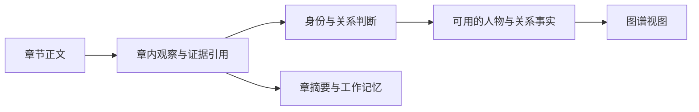
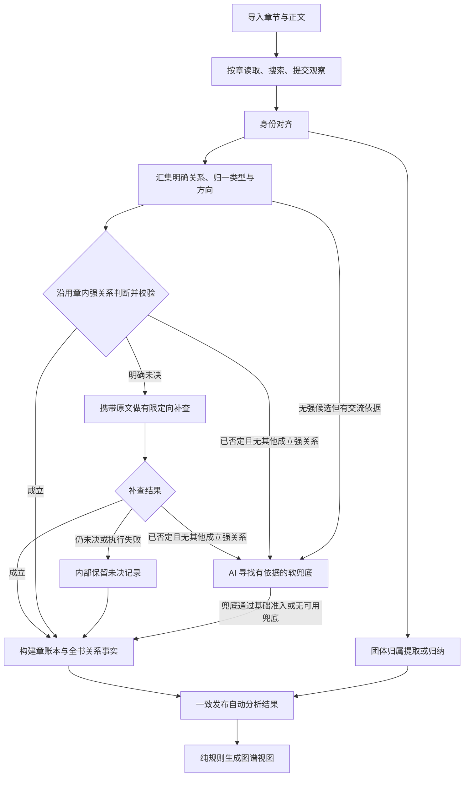

# ZhiYing 设计

| 项 | 内容 |
|---|---|
| 依据 | [PRD](./PRD.md)（产品行为唯一来源） |
| 状态 | 已在 `zhiying_backend/` 实施：导入、整书分析 / 单章重跑、后处理判断、团体归纳、发布、出图与查询，以及 TXT 导入、账号、按用户隔离、用量上限、秒传第一版、后台管理与反馈；前端已接入。按章正文跨书复用仍待实现，见 [todo](./todo.md) |
| 分工 | 本文写「系统怎么做」：领域模型、分析流程、模型调用点、存储与重跑。模块分层与技术选型见 [ARCHITECTURE](./ARCHITECTURE.md)；实施顺序与待定事项见 [todo](./todo.md) |

产品规则（软关系兜底、基础证据、不做人工纠错等）只写在 PRD，本文引用章节号，不重复抄写。设计变更直接改本文，不再新开平行设计稿。

---

## 1. 设计主线

同一个关系对象若同时充当模型输入、抽取记录、归一结果、验证状态、落盘结构与接口返回，多个阶段就会就地改写它。设计主线是**把观察、判断、事实、视图分开**：

- 章内观察只是候选，保存成功不等于成立。
- 图是正式结果的派生视图；摘要只提供上下文，关系结论必须回到正文依据（PRD §4.3）。
- 这些是语义边界，不要求每个概念一张表、一个服务或一次模型调用。
- 名称不等于身份：名称索引返回候选集合，由身份决策绑定 ID（§2.2、§3.2）。
- 不设通用收尾校对：身份歧义归身份解析，摘录错误在提交时退回，语义疑点有限补查（§3.4）。

---

## 2. 领域模型

### 2.1 书籍、章节与摘录

| 模型 | 关键字段 | 不变量 |
|---|---|---|
| `Book` | `BookId`、标题、作者、源文件引用、导入版本 | 书的身份不随分析任务改变；不塞入任务运行状态；同一任务登记锁内按源文件命中时共享书，写操作先分叉；用户归属通过 `shelf_items` 关联（§5.4–5.5） |
| `Chapter` | `ChapterId`、书 ID、顺序、标题、正文版本 | 章节 ID 与排序分开；导入修订不能悄悄改变已有引用含义 |
| `TextSpan` | 章节 ID、正文版本、起止位置、坐标单位 | 区间属于该版本正文；起点小于终点且不越界 |
| `EvidenceRef` | 证据 ID、原文片段集合，或基础模式的章节与说明 | 有引文时由程序按区间读取，各片段分离；无引文时不得伪造定位成功 |
| `ChapterExtraction` | 抽取 ID、章节 / 正文版本、模型与提示版本、观察集合 | 已提交的原始记录不被后处理就地改写；重跑产生新记录 |
| `ChapterSummary` | 章节 ID、摘要、所属抽取版本 | 仅用于记忆，不作为关系来源 |

- 「哪些章参与分析」是可检查的结论（`ChapterInclusion`）：目录页、版权页、前后置说明、附录资料与字数低于 `zhiying.import.min-chapter-words` 的章保留在书中，带原因标记为不参与，不直接丢弃。
- 证据工具优先让模型选择程序返回的片段 ID，也可提交摘录与位置由程序核实。同一句重复出现时按位置选定，不能因出现两次就判无效。
- 字符坐标必须明确单位：Kotlin `Char` 是 UTF-16 代码单元，补充平面字符占两个位置；外部来源的位置按正文版本和引文重新定位；测试覆盖扩展汉字、表情、换行与 EPUB 文本清洗。

### 2.2 人物与名字

| 模型 | 关键字段 | 用途 |
|---|---|---|
| `PersonMention` | 提及 ID、章内局部人物 ID、称呼、上下文与来源 | 本章提到了谁，含无姓名但可稳定识别的人物；不必覆盖每个代词 |
| `Person` | 稳定 `PersonId`、正式名或稳定称呼、别名、简介、性别、重要度 | 书内人物身份与当前资料 |
| `NameBinding` | 名称、人物 ID、名称种类、来源章、归属依据 | 已成立的正式名 / 别名 / 稳定称谓；按名称检索返回候选集合，名称不唯一 |
| `IdentityDecision` | 被处理的提及 / 人物、同人 / 不同人 / 未决、依据 | 谁与谁是同一个人，保留决策来源 |
| `IdentityMap` | 局部人物引用 → 书内人物 ID | 所有关系端点都通过同一份映射解析 |

- 人物 ID 独立于展示名；后来补充正式姓名不新建身份。`Person` 的别名列表由名称绑定投影，避免两套写入来源。
- 「父亲 / 师父 / 那个老人」的单次指向记录在 `PersonMention` 与身份映射中，不写成全书别名（PRD §5.3）。
- 候选组不等于合并组：A 像 B、B 像 C，推不出三者同人。模型可返回多个子组与未决项，程序校验覆盖范围、未知 ID 与矛盾决策。
- 正式名、别名直接桥接候选；稳定称呼只在共用它的人物不超过上限（默认 4，可配）时桥接，「仆人」「老板娘」这类多人共用的泛称不桥接。
- 简介、性别、重要度随身份主张写入人物，只补空缺；重要人物的全书简介在后处理统一生成（§3.2）。
- 合并不靠全项目替换 ID：保留稳定身份引用与合并映射，结果构建时统一重映射关系、事件和团体成员；合并后产生自环的关系需重新处理。
- 只做来源追踪与当前身份映射，不实现按章节回放的历史人名册。

### 2.3 关系、类型与互动

| 模型 | 关键字段 | 边界 |
|---|---|---|
| `RelationType` | 类型 ID、定义、硬度、方向、两端角色、同义名、内置 / 书内来源 | 半开放数据，不能写死为 Kotlin 枚举 |
| `RelationCandidate` | 候选 ID、局部人物端点、已知类型或新类型建议、原文描述、证据 | 原始观察，不带模型自定的「已确认」标志 |
| `InteractionObservation` | 两个人物、交流描述、证据 | 软兜底的输入，不自动入账为关系 |
| `TypeResolution` | 候选 ID、规范类型、端点方向映射、理由 | 回答「属于什么关系」，不回答「是否成立」 |
| `RelationAssessment` | 候选 ID、语义结论、依据、未决原因、判断来源 | 章内首次判断或定向补查结论；不强制独立模型调用 |
| `RelationOccurrence` | 稳定记录 ID、人物端点、类型、来源章、证据、判断引用 | 章账本中的关系记录，未决 / 否定记录也保留以便追踪 |
| `RelationFact` | 关系键、通过准入的记录 ID 集合 | 出图用的关系事实；同一对人物可多种并存 |

- 关系键为 `(BookId, PersonId A, PersonId B, RelationTypeId)`，按键合并章节与证据。无向关系统一端点顺序；有向关系按类型定义的角色顺序存储，「甲是乙的父亲」与「乙是甲的孩子」须经角色转换再归一，不能一律排序。
- 硬度只是产品分类与显示规则，证据支持度是另一维：「亲子」可以未决，「相识」可以证据充分。
- 不推导完整亲属逻辑系统，也不把行为建成类型。「告别后走入树林」是事件，可作为判断上下文，不成为关系类型。

### 2.4 三种结果分开，不做大状态机

| 问题 | 结果类型 | 处理者 |
|---|---|---|
| 输入是否合法、引用是否有效 | 合法 / 结构错误 / 引用错误 | 程序，在工具边界即时反馈 |
| 语义是否成立 | 有支持 / 未决及原因 / 有反证 | 语义判断，必要时有限补查 |
| 是否满足准入 | 准入 / 尚不满足及原因 | 程序按基础证据条件（PRD §5.6）与判断结果决定 |

- 超时、取消、预算耗尽是执行结果，不等于「原文无法证明」。缺引文在基础模式下不等于不成立；提交对不上的引文仍是输入错误。
- 用 `sealed interface` 表达带理由的结果分支，用 `@JvmInline value class` 区分各类 ID。
- 领域对象是不可变快照；外部 JSON、持久化记录、领域对象、HTTP 返回在各自边界映射。

### 2.5 团体与图数据

| 模型 | 职责 |
|---|---|
| `AffiliationGroup` | 学校、机构、家族、生活圈等团体及名称来源 |
| `Membership` | 人物属于某团体的记录、角色、依据；一人可多条 |
| `LayoutPartition` | 当前图如何分块；区分显式团体与算法推断分区 |
| `GraphView` | 节点、边、可见标签、折叠标签、分区、过滤原因、导出范围 |

- 团体事实与布局推断分开：为摆图把某人放进某块，不证明他属于该组织。成员事实需回到正文，不能从已过滤的默认图倒推。
- `GraphView` 只读正式结果：先聚合多标签，再折叠软标签、过滤人物。未决记录与「已成立但默认折叠的软关系」必须分开，前者不能借「更多」混进图里。

### 2.6 任务与结果版本

- `AnalysisRun`：一次执行的范围、输入版本、预算、进度、章尝试、失败原因、取消情况。状态只有等待 / 运行 / 完成 / 失败 / 取消，完成时另带完整 / 部分说明。
- `ChapterAttempt`：某章一次尝试及抽取产物引用；一章失败不等于其他章失败。
- `AnalysisRevision`：一套彼此一致的人物映射、关系结果、类型定义和团体结果，记录输入抽取与策略版本。
- `PublishedRevision`：当前对外可读结果的指针。

章节覆盖、未决数、势力是否过期属于结果质量信息，不复用同一个状态字符串。任务失败时上一版已发布结果仍可读。

本期不设计人工编辑覆盖层（`Correction`）与审核队列。

---

## 3. 分析流程

流程（图中是职责顺序，不代表每个框一次模型调用）：

### 3.1 章阅读

输入：章节正文、人名册、类型库、预算；长篇时可加记忆（见下）。章 Agent 自行决定阅读、搜索与取证方式（PRD §4.2「过程松、出口紧」）。

章 Agent 可用的工具：按章 / 分段取正文、章内按人名与关键词搜索、查人名册、登记人物与别名、提交本章结果。工具处理器持有本章范围内的上下文，没有全库写权限；校验失败返回结构化错误供本轮修正。

输出三类加一份摘要：
1. 人物观察及名称归属；
2. 明确关系候选，带首次语义判断；
3. 可供兜底的实际交流观察，只保留足够支撑判断的片段，不建全量事件抽取。

规则：
- 高频关系优先引用类型库；新类型提交定义、角色与方向，不能把情节句子当标签。
- 已知有硬 / 中关系的人物对，不要求再生成软标签；交流观察不提前命名为「朋友」。
- 工具边界不因「已提交硬 / 中候选」丢弃软候选或交流观察：候选可能未决或被否定，是否用于兜底由 §3.5 在全书范围判定。
- 模型未调用提交就停手或步数用尽时：已有登记内容则由程序收尾并记警告；什么都没登记则记为执行失败，不产出可复用的空抽取。主动提交的空章节照常有效。
- 错人物 ID、越界片段、错引文在工具边界退回。正常候选与失败的工具调用分开保存。
- 基础证据准入：章节 + 非空说明，引文可选；提供引文时校验真实性。
- 新登记且作为关系候选端点的人物必须给本章简介，缺失时提交被工具退回；其他人物有依据就写（PRD §5.3）。

**阅读单元与调度：**
- 阅读单元是一章或长章的一段。不超过切段上限的章整章一个单元；超长章先定段数 n = ⌈字数 / 上限⌉ 再均分，切点按场景分隔行 → 段落 → 句末标点 → 硬切依次退让。短章不合并，来源、引文、重跑都以章为单位。纯规则，不做语义切片。
- 段单元只负责本段抽取，搜索、取证与引文校验覆盖整章；段首附上一段末尾一小段作提示，不归它抽取。同一章各段按顺序读：前一段完成并更新人名册后才启动后一段，后一段可直接绑定前一段登记的人物；不同章之间照常并行。同一章各段的抽取合并为一份章抽取（局部人物与候选按段加前缀），对外仍是一章一份结果。
- 滚动人名册：单元按阅读顺序排队进并发池，没有波次屏障。每个单元完成后立即做一次身份对齐的确定性部分（复用明确绑定，不调模型）更新人名册快照，之后启动的单元拿最新快照。第一个单元单独先读（暖启动），再放开并发。
- 注入方式：提示内只列精简名册（有上限，按重要度），其余用 `query_roster` 检索；绑定已有 ID 须给理由。局部绑定会因完成先后略有差异，由全书读完后的身份对齐统一复核。
- 单章重跑注入当前已发布版本的人名册，保持人物 ID 稳定。

**长篇记忆（二期）：** 第 k 章上下文 ≈ 大摘要 + 最近若干章细摘要 + 人名册摘要；摘要过长时压缩为大摘要。一期各单元不注入摘要，只注入人名册。

### 3.2 身份对齐

章阅读同时完成主要身份判断：返回局部人物、名称归属、来源章、简短理由与可匹配的已有 ID。程序按名称检索候选并复用明确绑定；命中已有 ID 时也要保存新别名。

读章期间只做确定性对齐（见 §3.1 滚动人名册）；歧义判断等全书读完后统一进行。同名或别名交叉只产生候选。真正有歧义时，应用预先打包候选人物资料、相关提及及各自原文上下文，模型返回结构化身份结论，程序校验后更新映射。不对全部名字再审一遍，不启动自由翻书的 Agent。批量处理有条数与输入长度上限，逐项保存；信息不足时保持独立，不阻断其他人物出图。

提示里的人物用短代号（P1、P2……）而非人物 ID：长 ID 会被模型改写（如丢前缀）导致结论被当作未知人物丢弃。需要模型回传人物的调用点（身份歧义、疑似强关系的源端）一律如此，程序按代号映射回 ID，也接受完整 ID。

歧义判断的提示里章节写成阅读序号（第 N 章）并列出每个候选人物的出场章节：人物资料只反映他出场那几章的情况，同一人在先后章节里换了年龄、学校、职业或身份属于经历变化，不算冲突；只有同一时期不可能并存的设定才判为不同人。被采纳的结论与依据、没有可用回答的问题都写入运行日志（`<data-dir>/logs/zhiying.log`），供事后追查为什么合并或没合并。

**全书简介：** 关系、补查与兜底定下后，为重要人物（出场章数 ≥ `core-min-appearance`，或有已成立的硬 / 中关系）生成全书简介：输入为该人物各章的简介与提及依据（按阅读顺序），有界小批结构化输出，不读原文。路人沿用首次出场章的简介，可为空。生成失败或预算耗尽时保留章内简介，不阻断发布。单章重跑只重写在重跑章出场的重要人物，其余沿用上一版。

### 3.3 全书关系归一

在本次分析范围内汇集候选：先精确去重、确定性匹配已有类型，再对剩余语义相近的描述组织有界批次判断。

| 缓存 | 适用范围 |
|---|---|
| 类型语义决策 | 定义、角色、方向等价的问题跨章复用；类型库或策略变更时失效 |
| 证据语义判断 | 仅在人物解释、规范类型、正文版本、证据上下文都相同时复用 |
| 章抽取 | 正文、输入、提示、模型配置未变时复用 |

「多章都用了朋友这个词」可共享类型定义，不能共享「这些人确实是朋友」的结论。身份合并或类型方向变化后，相关证据判断重新校验。

清晰候选沿用章内首次判断，经结构与基础证据校验后直接准入，不设全量复核门禁（PRD §5.6）。

### 3.4 有限补查

只处理明确未决的硬 / 中关系。未决原因用有限类型表达：

| 原因 | 后续动作 |
|---|---|
| 指代或说话者不明 | 回到身份上下文，补相邻对话或相关提及 |
| 类型 / 方向含糊 | 附类型定义与双方角色，重新判断 |
| 当前片段不足 | 扩充到句子 / 段落，必要时由应用准备有限的相关章节片段 |
| 比喻、尊称、传闻 | 针对疑点补查；仍不足则保留未决 |
| 供应商失败 / 超时 | 走执行重试，不伪造语义否定 |
| 摘录不合法 | 原工具当场反馈，不进入补查 |

- 应用在调用前准备：候选 ID、具体疑问、首次判断及理由、人物与别名、来源章与相关原文。上下文从原句、相邻句、所在段落开始，按对话边界处理指代，有界扩展；不硬编码「前后各两句」。
- 单项或有界小批，条数、输入长度、请求次数、耗时上限由应用控制，具体数值实施时定。请求次数上限按整个任务计，普通补查与 §3.5 兑底升级后的补查共用同一份额度；超出的记录保持未决。逐项保存，不再复核补查结果；单项未决或失败不回滚其他判断。

### 3.5 软关系兜底

产品规则见 PRD §5.5，这里只写判定时机：

| 人物对的情况 | 处理 |
|---|---|
| 已有成立的硬 / 中关系 | 不生成新软关系；历史软记录保留、默认折叠 |
| 两端都是路人（出场章数低于阈值），有交流依据 | 不调模型，直接记最粗的软标签（相识），来源为交流观察 |
| 至少一端是重要人物，无硬 / 中候选，有足够交流依据 | AI 先查漏：判断为疑似硬 / 中关系时生成强候选，附原文走补查；否则生成粗粒度兜底标签，须通过基础准入 |
| 只是同章共现 | 不补边 |
| 有未决硬 / 中候选 | 先等后续判断，不抢先生成软关系 |
| 强候选被否定，且无其他成立强关系 | AI 回看交流与上下文寻找兜底 |
| 仍未决 / 超时 / 预算耗尽 | 内部保留，不当作否定触发兜底 |
| AI 找不到有依据的兜底 | 不连边，保留强关系被否定的记录 |

- 「历史已有」指之前已入账的记录，不能先把本轮交流观察都转成软关系再宣称要保留。并行章节完成的先后不应影响最终生成多少软标签。
- 软关系记录首次准入及来源；来源在重跑中失效时重新评估，不无条件保留。
- 保留的历史软关系先按本轮身份对齐重定位端点（合并后自环、人物或类型已不存在的丢弃），再参与兜底判定与组装，两步用同一组人物键；否则重跑合并人物后会对同一对重复生成软关系。
- 各章仍可并行收集交流证据，不为确认「已有强关系」而串行化读章。
- 重要人物 / 路人按全书对齐后的出场章数划分，阈值默认与出图默认过滤相同（PRD §5.7.6），可配置。
- 查漏升级出的强候选只补查一轮：成立则入账，否定或未决则回落到软兜底 / 内部保留，不再循环。

### 3.6 出图与团体

应用用例加载同一结果版本，由领域纯函数完成：人物归一 → 多标签汇总 → 软标签折叠 → 人物过滤 → 聚焦 / 类型筛选 → 分区数据。

- 相同类型合并出现章节与证据；多种硬 / 中关系并列保留。
- 展示分 ≈ 类型基础分（硬 > 中 > 软）+ 出现章数 × 系数 + 有合格证据加分。只用于排序与默认过滤，不能决定事实成立，也不能让一种硬关系吞掉另一种。
- 人物出现次数按章去重；默认阈值、例外保留见 PRD §5.7.6。一条软边不能让普通人物绕过过滤。
- 导出 JSON 与页面共用同一份图数据构建结果。
- 团体归纳是全书级独立步骤（逐章猜会造出不一致的块名），输入为人名册、按章出场、章摘要与章内观察，输出区分团体事实与布局推断。分区失败的降级按 PRD §4.4。

章节聚焦（PRD §5.7.1）是同一结果版本上的查询条件，不生成新版本、不调模型：

- 投影前先按截止章 N 裁剪：关系记录只留章节 ≤ N 的出现与依据（全部被裁掉的标签不进图），人物出场集合也只数 ≤ N 的章。展示分按裁剪后的章数重算。
- 单章模式：人物限定为第 N 章出场者，不做路人阈值过滤；标签标记是否含第 N 章依据（本章 / 背景）；节点照常带全书简介，本章记录由前端从章结果补充。
- 累计模式：人物为前 N 章出场者，路人阈值按前 N 章内的出场章数判定。
- 团体归属、称呼、重要度沿用全书结果，因此不构成严格防剧透；严格防剧透需按章生成快照，后续另行设计。

---

## 4. 模型调用点

Agent 只是基础设施里的一种执行方式（多轮工具循环），领域层不出现 Agent。按「每个调用点回答什么问题」建模：

| 调用点 | 执行形式 | 应用层接口（建议名） | 领域产物 |
|---|---|---|---|
| 章阅读 | 多轮工具循环，唯一保留的 Agent | `ChapterReader` + 本章会话 | `ChapterExtraction` |
| 类型归一 | 有界小批，一次结构化输出，适合小模型 | `RelationTypeResolver` | `TypeResolution` |
| 团体归纳 | 一次结构化输出，输入过长再加检索 | `AffiliationExtractor` | `AffiliationGroup`、`Membership` |
| 身份歧义 | 有界小批结构化输出 | `IdentityDisambiguator` | `IdentityDecision` |
| 定向补查 | 单项或有界小批结构化输出 | `RelationRechecker` | `RelationAssessment` |
| 否定后软兜底 | 结构化输出 | `SoftFallbackFinder` | 软关系候选 + `RelationAssessment` |
| 全书简介 | 有界小批结构化输出，只用各章简介与提及 | `ProfileWriter` | `Person` 简介 |
| 布局分区 | 纯算法，不调模型 | 无 | `LayoutPartition` |

- **章阅读**不拆成认人与抽关系两个 Agent：同一次阅读同时服务身份与关系，拆开要读两遍并丢上下文。本章会话 `ChapterSession` 负责在会话内校验人物 ID、区间、引文，工具回调只做 DTO 转换。
- **类型归一**独立成接口，是因为类型语义缓存可跨章复用，证据判断不能。
- **补查与兜底不合并**：两者之间要先由程序判断是否还有其他成立的强关系，兜底还要处理从无强候选的人物对。
- 不做的抽象：领域层不建 `Agent` 基类；不提供通用 `Judge<I, O>` 或 `ask(prompt): String` 接口；人物、类型、团体三种对齐不抽统一框架（人物合并要改关系两端，类型映射要处理方向，团体合并只影响成员）。

复用放在基础设施：一个结构化调用执行器（预算、重试、用量记录、解析）加一个工具循环执行器，各调用点用哪档模型由配置选择。结构化输出用提示内格式说明加解析 JSON，不强制 `tool_choice`（DeepSeek 思考模式会拒绝）。骨架探针已验证思考模式开 / 关两种情况下对话、单轮工具调用、结构化输出可用；思考模式下的多轮工具循环（需回传思考内容）尚未验证。思考模式默认关闭，需要的调用点单独开启。

---

## 5. 存储、并发与重跑

### 5.1 存储

本地 / 私有部署用 SQLite 存结构化记录与章节正文，源 EPUB 按内容摘要存为不可变文件。理由是一次人物合并、关系更新与结果发布需要一致提交。结果版本整体序列化为一行带格式版本号的 JSON，另有已发布指针表。

- 概念集合：书与章节、抽取记录、人物与身份决策、关系类型与判断、正式结果、团体归属、任务进度。低频查询的抽取载荷可存带版本的 JSON；需要约束与索引的 ID、引用、版本关系显式建表。
- 模型请求不持有数据库事务。各章产物先独立保存，构建新结果写入未发布版本，最后用短事务校验引用并切换当前版本。SQLite 单写，写入需短且串行协调，繁忙时有界重试。
- 若暂用 JSON 存储，也须实现相同的存储接口与发布契约；多文件原子写不等于结果一致。不引入分布式事务、消息队列或事件溯源。
- 删除书与清空分析（PRD §5.10）：分析与版本表不对书表建外键，按 `book_id` 逐表删除，与删书表在同一事务内完成；执行期间持有任务登记锁，该书有运行中任务时拒绝、也不能新启动任务。源文件在事务提交后、且已无其他书引用时才删除。类型语义缓存与具体书无关，不删；用量流水独立保留，不随删除书或清空分析删除（§5.6）。应用层先检查条目所有者与示例书权限（§5.5）；删除条目时仅回收无当前或 pending 引用的书，清空共享书先分叉并立即切换条目（§5.4）。

### 5.2 运行与结果分开

- 同一本书同时只运行一个会发布结果的任务；同书章节可并行，模型调用有统一并发与预算限制。
- 取消与超时由应用层掌握：正常完成、用户取消、供应商错误、部分章失败分别记录；取消信号不能被通用异常吞掉。
- 进度写入运行记录，HTTP 订阅只负责传递，页面断开不影响任务。
- 发布时校验输入抽取版本与当前发布版本未被其他任务改变；一次图查询固定一个结果版本。
- 失败发布（PRD §5.9）：整书分析中只要有章读取失败，本次不发布，不产生带缺章空洞的结果；成功章的抽取照常保存，再次启动分析沿用仍有效的抽取（正文修订、模型、提示词版本未变），只补读失败章。取消同样不发布。单章重跑失败时上一版保持不变。
- 章抽取按章保存、重跑产生新记录并移动当前指针；任务快照与各章状态落库，SSE 只在内存任务存在时实时推送，其余情况由快照合成终态事件。

### 5.3 单章重跑

1. 只重抽指定章，其他章的有效抽取直接复用。
2. 用有效抽取与输入未变的已有判断构建新结果。
3. 重算受人物归并、类型变化影响的全书派生关系。首版可全书重建派生数据，但不等于重调所有模型。
4. 按来源保留仍有效的旧软关系准入记录，重新校验因重跑而失效的依据。
5. 校验一致后发布；失败时保留上一版，失败运行仍可诊断。

人物 ID、类型 ID 与有效来源引用在重跑中保持稳定，避免身份漂移与重复关系。

### 5.4 秒传与共享结果

产品规则见 [PRD §5.14](./PRD.md#514-秒传)。多个书架条目指向同一本书，写操作先分叉；命中不复制正文与整份结果。

**版本判定：** `books.import_version` 保存导入规则版本，常量 `IMPORT_VERSION = 1`；EPUB 切章、清洗或章节选择规则改变时递增，已有书迁移为 1。`analysis_revision.method_version` 由章阅读、身份歧义、类型归一、补查、软兜底、全书简介及团体归纳按生效模型配置快照（§5.7）的实际模型 ID、思考开关与提示版本拼接后取 SHA-256，自动生成。`full_book` 仅在 FULL 任务未限定 `toChapter`、成功发布且 `analyzedChapters` 覆盖全部参与分析章节时为真。`AnalysisRevision.reusableFor(currentMethod)` 以完整标记与方法版本作纯判断；旧结果仍可读取，缺少标记时不能秒传。

**书架条目：** `shelf_items` 取代 `book_owners`。

| 列 | 说明 |
|---|---|
| `id` | 主键，对外接口里的书 ID 即条目 ID |
| `user_id` | 所有者，引用账号 |
| `book_id` | 当前结果所在书，引用 `books` |
| `pending_book_id` | 分叉后首次发布前的新书，可空，引用 `books` |
| `original_name`、`created_at` | 本条目的上传文件名与时间 |

启动时在事务内把旧归属迁为条目，条目 ID = 原书 ID，然后删除旧表，已有链接、示例 slug 配置和前端缓存不变。应用层 `ShelfItems` 解析条目：图、章节与结果读 `book_id`，任务、进度与 SSE 优先读 `pending_book_id`；权限只看条目。任务快照与 SSE 仅返回该条目发起的任务，不回放原分析者的历史用量。

**上传顺序：** 在 `AnalysisRunner` 的任务登记锁内检查扩展名与文件大小 → 服务器计算 SHA-256 → 本人同摘要条目直接返回 `existing: true` → 检查新增书数额度 → 查询候选。候选须同源文件摘要、当前导入版本、已发布结果 `reusableFor` 为真且无未结算任务，按最近发布时间选择。命中仅新增条目并返回 `reused: true`；未命中才解析、保存源文件并事务保存书、条目和章节。命中判定与新增条目和任务启动互斥。TXT 先按自动选择得到分章方案，候选还须 `books.split_rule` 相同（§5.9）。

**共享与分叉：** 当前指针或 pending 指针合计不止一个条目引用时为共享；没有 pending 的独占书原地写入。

1. 整书分析、单章重跑先检查当前书与 pending 书空闲；已有 pending 时沿用它，否则从同一源文件重新导入为新书、新章节 ID。按阅读顺序对应章节，复制当前章抽取并替换章 ID；现有抽取存储格式只在外层记录章 ID，局部人物、依据和引文在解码时一起重定位。全程不调模型。
2. 分析在新书上按 §5.2 的规则沿用仍有效抽取，按 §5.6 记发起者用量；新书 ID 先记为 `pending_book_id`，图与结果仍读旧书。
3. 新书首次发布事务内同时切换发布指针与条目 `book_id`，清掉 pending；失败或取消不切换，分叉书与成功抽取保留供重试。清空分析不复制抽取，立即切换新书；删除废弃 pending 时仍检查引用。
4. 删除条目与回收无任何条目（含 pending）引用的书在同一事务完成；首次发布后无引用的旧书也回收，源文件沿用 §5.1 的引用规则。

累计 token 从 `usage_ledger` 按当前用户与条目统计，只在管理员的书接口中返回；普通用户与访客不返回该字段（§5.7），秒传条目的实际用量为 0；输入、输出、请求数也保存在独立流水，清空分析后仍保留。示例 slug 始终指向管理员条目；管理员分叉发布后公开链接随条目更新，已秒传者仍看旧版。反馈同时保存提交时的条目、实际书与结果版本（§5.8）。

按章正文跨书复用抽取仍待实现，见 [todo](./todo.md)。

### 5.5 账号、会话与书籍归属

产品权限见 PRD §5.11–5.12。账号与归属使用 SQLite，条目保存所有权，书、章节、任务与结果按 §5.4 共享或分叉；完整上传后才能判定秒传，不能只凭源文件摘要取得结果。

| 表 | 字段与约束 |
|---|---|
| `accounts` | `id` 主键；`username` 唯一，`COLLATE NOCASE`；`password_hash`；`role` 为 `ADMIN` / `USER`；`created_at` |
| `invitations` | `code` 主键；`max_uses > 0`，`used_count` 默认 0 且满足 `0 ≤ used_count ≤ max_uses`；`created_by` 外键引用 `accounts(id)`；`created_at` |
| `account_sessions` | `token_hash` 主键；`user_id` 外键引用 `accounts(id) ON DELETE CASCADE` 并建索引；`expires_at` 为 epoch 秒 |
| `shelf_items` | 字段见 §5.4；`user_id`、`book_id`、`pending_book_id` 分别建索引；书的引用不级联删除条目 |

条目限定访问边界，应用层先查条目归属再解析实际书。累计 token 按本人条目查询独立流水（§5.6），只对管理员输出（§5.7）。反馈先检查条目读权限与登录身份，私有书只能由书主提交；管理员查看反馈不开放其他私有数据（§5.8）。

**事务与用例顺序：**

1. 首次启动读取管理员引导配置，创建一个管理员；随后把缺少条目引用 的已有书归入该管理员，不删除或重建已有书、章节和分析数据。管理员已存在时不通过引导密码重置账号；部署参数见 README。
2. 注册先校验邀请码与账号输入，再在同一事务中消耗一次邀请名额并创建账号；失败时两者一起回滚，不能超用或丢失名额。
3. 上传在任务登记锁内按 §5.4 检查大小、本人重复、书数与复用候选；未命中才解析，在同一事务保存新书、条目与章节，源文件仍按 SHA-256 保存。
4. 登录校验密码后创建数据库会话；退出删除当前会话。管理员重置密码时同时撤销目标账号的全部会话。
5. 书架查询限定本人条目，加上已发布的配置示例条目。所有书籍读取与写入入口都先检查条目权限，再按 §5.4 解析结果或任务书；管理员评测也只匹配本人条目，评测与模型诊断还需管理员身份。

**密码与浏览器会话：**

- 密码使用 `PBKDF2WithHmacSHA256`，每个密码随机 salt，600000 轮；不保存明文密码。
- Cookie 携带随机 256-bit token，数据库只保存它的 SHA-256 哈希；每次请求按哈希查询并校验会话到期时间。SSE 每次发送事件或心跳前再次检查会话，退出或密码重置后关闭连接。会话时长由 `zhiying.accounts.session-lifetime` 配置，默认 `30d`。
- 会话 Cookie 为 `HttpOnly`、`SameSite=Lax`；`Secure` 由 `ZHIYING_COOKIE_SECURE` 控制，本地 HTTP 默认 `false`，公网 HTTPS 设置 `true`。
- 非安全方法请求必须带 `X-Requested-With: XMLHttpRequest`，缺失时拒绝；不开放 CORS，前端与 `/api` 使用同一站点，开发时通过 Vite 代理。
- 访问控制按会话、书主与已发布示例共同判断，不再使用 `examples.public-only` 绕过账号权限。管理员可重新分析配置示例，但角色不授予读取他人私有书的权限。

### 5.6 用量上限

产品规则见 [PRD §5.13](./PRD.md#513-用量上限)。

**配置：** 所有上限放 `zhiying.quota.*`，由 `ZhiYingProperties` 绑定为应用层 `QuotaSettings`，后台仅只读展示（§5.7）。

| 键 | 含义 | 默认 |
|---|---|---|
| `max-books` | 每人书数，不含配置为示例的书 | `0` |
| `max-analysis-chars` | 每人累计分析字数 | `0` |
| `max-file-size` | 单个上传文件，`DataSize` | `200MB` |
| `max-concurrent-tasks` | 每人同时运行任务数，整书与单章重跑合计 | `0` |
| `daily-token-budget` | 全站每日 token | `0` |
| `time-zone` | 当天边界的时区 | `Asia/Shanghai` |

数值上限 `0` 表示不限；运营方在开放内测前配置实际额度。multipart 的 `max-file-size` 默认 `200MB`，必须不小于应用上限；`max-request-size` 默认 `201MB`，需容纳表单开销。应用文件大小不限时，multipart 两项也须不限。启动时绑定并校验这些关系。

**流水与计量：** `resources/schema/70-quota.sql` 按现有 `CREATE TABLE IF NOT EXISTS` 约定建 `usage_ledger`，只追加、结算时更新一次，不对书建外键，删书和清空分析均不删除。

| 列 | 说明 |
|---|---|
| `task_id` | 主键，每个任务一行 |
| `user_id` | 发起者 |
| `item_id` | 发起分析的书架条目 ID；旧流水因迁移条目 ID = 书 ID 无需改值 |
| `chars` | 未结束时为预占字数，结束后为实际计费字数 |
| `tokens` | 本任务总 token，未结算时为 0 |
| `input_tokens` / `output_tokens` / `requests` | 结算后的输入、输出与请求数；旧流水从仍在库的任务回填 |
| `started_at` / `settled_at` | 任务开始时间 / 结算时间，结算前 `settled_at` 为空 |

每人已用字数为该用户流水的 `SUM(chars)`，包含预占；书数为本人 `shelf_items` 条目数，排除示例配置中的书。全站今日 token 为配置时区当天 `started_at` 的流水 `SUM(tokens)`，加上内存中未结算任务的实时 token；任务总量来自 `ModelCallControl.budget.usedTokens`，包括阅读、后处理与团体归纳。

**领域规则：** `domain/quota` 的 `QuotaLimits` 和 `UsageSnapshot` 保存上限与用量，后者以纯函数返回 `sealed QuotaCheck`（`Allowed` 或 `Exceeded(item, needed, remaining)`）：

- `checkUpload(fileBytes)`：文件大小 → 书数。
- `checkAnalysis(chars)`：全站预算 → 本人同时任务数 → 剩余字数。
- 管理员只跳过书数、字数与同时任务数；文件大小与全站预算照常检查。

应用层 `QuotaUsage` 读取用量，并把拒绝结果转为 `AppException`；外部存储能力仅定义 `UsageLedger` 接口，由 SQLite 实现。

**上传顺序：** 见 §5.4；本人重复上传不新增条目、不占新书名额，仍检查文件大小。秒传命中占用一个书数名额，不创建分析流水、不检查剩余分析字数。

**分析顺序：** `AnalysisRunner.launch` 在已有 `synchronized(runs)` 锁内：

1. 读取章正文并判断可沿用抽取；整书待读字数为无可沿用抽取的章 `wordCount` 之和，`force` 时计所有章，单章重跑计该章。
2. 读取本人用量、全站今日 token，按领域规则检查。
3. 同一事务保存任务与流水，`chars` 预占待读字数。
4. 登记记录发起者的 `AnalysisRun` 并启动线程，阅读阶段使用启动前确定的抽取复用结果。
5. 任务结束后持有登记锁结算流水：已开始读的章计字数，包括失败与取消中的章；未开始与复用的章不计，`tokens` 写本任务总量。结算前该任务继续占用运行名额、不能删除书或清空分析；避免终态出现到结算之间的竞态及 token 重复计量。

`ChapterRun.startedAt` 在首次提交实际读取单元前持久化，复用与未启动章保持空。已有数据库启动时通过表结构检查补齐 `analysis_task_chapter.started_at`，不删除原数据。服务重启先按该标记及章节 `word_count` 结算遗留流水、从任务快照恢复 token，再由 `interruptRunning` 将运行中任务收口为失败；重复启动不重复结算。上线前的历史任务不回填额度。进程突然退出时，已消耗但尚未写入任务快照的 token 无法恢复。

**接口与前端：** `GET /api/me/usage` 只接受登录账号，返回 `{books: {used, limit}, chars: {used, limit}}`。管理员每人额度返回 `limit: 0`。书架打开及书列表刷新后读取用量，顶部显示启用的「已用 / 总额」，`limit: 0` 隐藏该项。`QUOTA_EXCEEDED` 明确超限项、所需量和剩余量；`DAILY_BUDGET_EXHAUSTED` 与 `FILE_TOO_LARGE` 使用已登记错误码；前端直接展示这些消息。

---

### 5.7 后台管理与生效模型配置

产品规则见 [PRD §5.15](./PRD.md#515-后台管理)。`/admin` 仅管理员可见，API 沿用 `accounts.requireAdministrator`；用量与模型配置挂在 `/api/admin/*`，评测和诊断继续复用原接口权限。

**页面：** 用量、模型、评测、账号与反馈五个页签。现有 `EvalPage` 与 `AdminPanel` 直接挂载；`/eval` 跳转 `/admin?tab=eval`，账号弹窗与书架入口改为后台。反馈挂载 `FeedbackPanel`，地址为 `/admin?tab=feedback`（§5.8）。

**token 输出：** 书列表与详情仅管理员返回 `token_usage`；任务快照、SSE progress / done 仅管理员返回请求数及输入 / 输出 / 总 token，不返回零值占位。前端没有用量字段就不显示。`/api/me/usage` 仍只返回本人书数与字数；管理员用量看板不授予私人正文、结果或图谱读取权限。

**用量看板：** 查询独立 `usage_ledger`，不新建表、缓存或预汇总：

- `GET /api/admin/usage/daily?days=30`：`days` 为 1–30，按 `zhiying.quota.time-zone` 自然日汇总，以任务开始日归属；今日在任务登记锁内额外计入未结算任务的实时 token，与预算检查同口径。返回只读上限与时区。
- `GET /api/admin/usage/users`：按用户汇总字数、token 及书架条目数；字数包含未结算任务的预占。
- `GET /api/admin/usage/books`：按条目汇总 token，带书名与用户名。删除条目后流水仍显示为「已删除的书」，不开放私人书链接。

**模型配置：** 新表 `model_settings`：

| 列 | 说明 |
|---|---|
| `call_point` | 主键，`READING` / `POST_PROCESS` / `AFFILIATION` |
| `provider_id` | 服务商 ID，`default` 为部署配置的内置服务商 |
| `model` | 模型名，空值使用 `zhiying.llm.model` |
| `thinking` | 是否开思考 |
| `updated_at`、`updated_by` | 最近修改时间与管理员 ID |

读取顺序：表内覆盖值优先，否则用 `zhiying.reading` / `post-process` / `affiliations` 的现有 `model`、`thinking`，服务商为内置；模型名为空时回退默认模型（仅内置服务商允许留空）。这是自有参数由 `ZhiYingProperties` 绑定的唯一持久化覆盖例外，部署值继续作为缺省。

**服务商：** 内置服务商 `default` 来自 `zhiying.llm.*`，只读。后台新增的服务商存 `model_providers`（名称、地址、思考参数写法、密钥密文与末 4 位）；密钥用 `zhiying.llm.secret-key` 经 SHA-256 派生的 AES-GCM 密钥加密，未配置主密钥时不能保存或使用后台服务商，主密钥更换后需重填密钥。被分析环节引用的服务商不能删除。`ProviderChatModels` 按服务商建 `OpenAiChatModel` 并按修改时间缓存；思考参数写法有 `DEEPSEEK`（`thinking.type`）、`ENABLE_THINKING`（`enable_thinking`）、`NONE`（不发送）。模型列表实时请求 `GET {baseUrl}/models`，失败时前端仍可手填。

- `GET /api/admin/model-providers` 列出服务商（不含密钥）；`POST` 新增，`PUT /{id}` 修改（密钥留空保留原值），`DELETE /{id}` 删除；`GET /{id}/models` 拉取模型列表。

任务登记时一次读取生效配置（含服务商 ID），放入 `ModelCallControl.models` 的 `ModelSnapshot`；读章、各后处理调用与团体归纳按请求设置 options，任务中途不重新读取。抽取沿用判定使用同一快照的阅读来源版本，来源包含思考开关，非内置服务商的模型记为「服务商ID/模型名」作标识；结果发布按任务快照计算方法版本，上传秒传按当时生效快照计算方法版本（§5.4）。

- `GET /api/admin/models` 返回三环节生效服务商、模型、思考开关及来源（后台 / 配置文件）；`PUT /api/admin/models/{callPoint}` 保存；`DELETE` 删除覆盖值，恢复配置文件。
- 测试连接复用 `GET /api/diagnostics/model`，增加可选 `provider`、`model` 参数并沿用 `thinking`。报告仅返回模型名与各项协议检查；失败保持 502 完整报告，不返回地址与密钥，底层连接异常只返回分类。

shortcut: 不校验模型名是否存在于服务商，没有统一列模型接口；保存后由管理员手动测试连接确认。

### 5.8 反馈

产品规则见 [PRD §5.16](./PRD.md#516-反馈)。反馈独立于分析结果，只追加报告，不修改或发布结果。

**模型与存储：** `domain/feedback/Feedback` 在构造时校验身份、对象反馈的书与对象引用、版本、范围、关系键格式和说明长度；类别与对象种类使用枚举。说明最多 200 个 Unicode 码点，对象标识和名称各不超过 500 个 UTF-16 代码单元；应用层把校验错误转换为 `AppException(INVALID_ARGUMENT)`。

表 `feedback`：

| 列 | 说明 |
|---|---|
| `id`、`created_at`、`user_id` | 反馈 ID、服务端提交时间、当前会话用户 |
| `item_id`、`book_id`、`book_title` | 提交时的书架条目、实际书与书名快照；通用反馈为空 |
| `revision_id` | 图查询返回的真实结果版本，应用层确认版本属于该条目的实际书 |
| `target_kind` | `PERSON` / `RELATION` / `GROUP` / `GENERAL` |
| `target_ref` | 人物 ID；两端人物 ID 与类型 ID 以 `/` 连接的关系键；势力分区块 ID |
| `target_label` | 提交时显示名快照，如「甲—乙：师徒」；势力重跑后 ID 不稳定，靠快照阅读 |
| `category` | `DUPLICATE_PERSON` / `WRONG_RELATION` / `WRONG_GROUP` / `MISSING` / `OTHER`，可空 |
| `note`、`scope` | 可选说明；对象反馈范围为 `all` / `single:N` / `upto:N` |

反馈表不使用指向书或结果的级联外键，因此删除条目、清空或重跑仍保留快照。按条目和提交时间建索引；同一对象不去重。

**接口与权限：**

- `POST /api/books/{bookId}/feedback` 与 `POST /api/feedback`（通用）：必须登录；对象反馈先检查条目读权限，再解析实际书、校验版本并保存。拦截器对反馈采用读权限，允许普通登录用户反馈已发布示例书；跨站写请求仍被拒绝。成功返回 `204 No Content`，与共享客户端 `request()` 的空响应契约一致。
- `GET /api/admin/feedback?book=`：仅管理员；`book` 为书架条目 ID，省略时含所有对象与通用反馈。返回反馈快照、当前公开示例 slug 和当前对象是否仍存在；私人书不加载其结果、不提供链接。
- `GET /api/admin/feedback/export?book=`：同样限定管理员，返回 `application/x-ndjson` 下载，每行一条上述反馈记录；关闭缩进，保留合法 JSON 字符串转义。供人工整理成评测样本（§7），不自动转换为评测集。

**前端：** `FeedbackButton` 共用原生弹窗，在点击时固定对象、图响应中的 `revision_id` 和 `chapter_focus`；类别与说明可空，提交中防止重复点击，失败保留输入，成功显示「已收到」。人物与每种关系详情直接提供按钮；势力块点击后显示按钮，图例同时提供可键盘访问的势力入口；顶部栏提供通用反馈。

后台 `FeedbackPanel` 按书筛选和分组、导出当前筛选反馈。仅已发布示例书的现存人物或关系通过 `bookLinks.ts` 生成当前版本全书视图链接（关系聚焦其中一端）；当前对象不存在时展示「该对象在当前结果中已不存在」。私有书仅展示报告与快照，不改变读书权限。

shortcut: 不限制提交频率，邀请制内测暂不增加限流；若开放访客提交，再加每人或每 IP 的每日上限。

### 5.9 TXT 导入与分章方案

产品规则见 PRD §5.1。应用层 `TxtParser` 由 `infrastructure.txt.TxtBookParser` 实现，与 EPUB 解析器一样产出 `ParsedBook`；`ImportBook` 按扩展名选择解析器，其余流程（保存源文件、建书、分析、出图、导出）不变，章节是否参与分析同样由 `ChapterInclusion` 判定。

**解码与清洗：** 有 BOM 按 BOM（UTF-8 / UTF-16）；否则严格按 UTF-8 解码，失败再用 GB18030；都失败或含 NUL 字符时报 `UNREADABLE_BOOK`。统一换行、去行尾空白；行首缩进保留到切章之后。shortcut: 不识别 Big5（GB18030 解 Big5 不报错只出乱码），遇到繁体书源再加中文字符比例检测。

**分章方案：** 预置一组按行匹配标题的正则，放在资源文件 `txt-toc-rules.json`（字段 `id`、`name`、`rule`、`example`，可选 `extra` 匹配卷标题、楔子等附加标题），新增方案只改这个文件。`id` 一经发布不改，书记录的是 `id`；要改正则就新建 `id`。现有方案按优先级：`zh-volume-chapter`（卷 + 章）、`zh-special`（第 X 章及序章、楔子、番外等）、`zh-chapter`、`number`、`en-chapter`、`bracket`，另有内置的 `length`（约 `zhiying.import.txt-segment-chars` 字一段，在段落边界切开，末段不足半段并入上一段，标题「第 N 段」）。

- 抗误报：标题独占一行，行首全角空格缩进视为正文；去缩进后不超过 35 字；以句号、问号结尾的不算。
- 切分：第一个标题之前的内容为「开篇」；连续标题（卷标题、只有标题没有正文的章）拼到下一章标题上（「第一卷 xx · 第一章 yy」）；结尾没有正文的标题丢弃。
- 自动选择：按优先级试切，取第一个「章数 ≥ 2、平均章长在 `zhiying.import.txt-auto-min-chars`–`txt-auto-max-chars` 之间」的方案，带 `extra` 的方案还要求附加标题至少命中一次；都不满足用 `length`。取第一个而不取命中最多：数字序号类会把正文列表也算进去。

**存储与改选（`ResplitBook`）：**

- `books.split_rule` 保存当前方案 `id`；EPUB 为空。
- `GET /api/books/{id}/split-preview`：对源文件跑每种方案，返回章数与开头、中间、结尾各 3 个标题，标出当前方案；纯计算，不落库。
- `POST /api/books/{id}/split {rule}`：在任务登记锁内要求书空闲，从源文件按新方案导入新书，同一事务切换条目（等同「清空分析 + 换方案」的分叉，§5.4），再回收不再被引用的旧书。权限同清空分析，示例书不可改；不调模型，不计额度。方案未变且无进行中的分叉时不做任何事。

shortcut: 不支持用户自定义正则与多方案组合；以后要做，就在资源文件之外再读一份用户规则，接口不变。

## 6. 风险与控制

| 风险 | 控制 |
|---|---|
| 错误合并导致关系串人 | 名称不是身份；身份正反例独立验收；合并影响统一处理 |
| 软兜底过宽或过窄 | 明确交流依据与类型下限；单独看孤立人物与错误软边 |
| 稀有关系被粗类型吞掉 | 定义、方向、角色等价才归一；保留新类型入口 |
| 有限补查损失召回 | 记录未决原因、补查命中与失败率，用离线评测选预算 |
| 句子切片破坏指代与对话 | 支持段落扩展与有限检索，加跨句样例 |
| 全书重建太慢 | 复用有效判断；区分纯计算重建与模型重跑，测量后再做增量 |
| 多人候选两两比较膨胀 | 名称 / 别名索引生成候选；限制泛称连接；批次有预算 |
| 类型库或上下文提示膨胀 | 高频类型优先、有限候选检索、同段证据去重 |
| SQLite 写竞争 | 短事务、单写协调，模型调用在事务外 |
| 秒传结果被他人操作改动 | 共享书上的写操作先分叉；命中与启动任务在同一个任务登记锁内互斥（§5.4） |
| 旧版分析方法的错误经秒传扩散 | 命中要求当前导入版本、各调用点模型与提示版本摘要及整书完整标记 |
| 通过书、章或任务 ID 越权读取 | 应用层先检查条目所有者或已发布示例权限，再解析实际书读取（§5.5） |

每次运行记录分阶段请求数、输入 / 输出 tokens、耗时、缓存命中、候选数、未决原因、补查次数与新增合格关系；未决、否定、已准入、默认可见四类结果必须可区分，供评测定义口径（§7）。

---

## 7. 评测

用标准标注衡量真实模型跑完整条流水线后的结果，用来比较提示词、模型、参数改动前后的差异。这是后台的管理员维护工具（PRD §5.15），不是读者功能，也不进入分析验收。

### 7.1 评测集

每个评测集一个目录 `eval/<集名>/`：

- `suite.json`：书名、源 EPUB 路径（相对评测集目录）、正文章数、标准人物与别名；
- `chapter_NNN.json`：逐章标准。标准章号 N 对应导入后第 N 个参与分析的章节。评分时核对章名，并检查标准引文能否在正文中找到，不符的写进报告「标注自检」，不中断评分。

标准关系分三层：

| 层 | 用途 |
|---|---|
| 必有 | 计入召回 |
| 可有 | 合理但偏软或偏事件；命中不算错，漏掉不扣分 |
| 禁止 | 高价值负例；同章出现已准入的该类关系即记一次违反 |

每条标准写可接受的类型：内置类型 ID，加上新类型名称关键词。本书新登记的类型 ID 为 `book:<名称>`，名称由模型起，只能按关键词认。有向的内置类型按标准写的源端核对方向；新类型不判方向。

### 7.2 流程

由管理员在 `/admin?tab=eval` 的评测页签触发：

1. **准备**：只在当前管理员拥有的书中按书名与正文章数查找；没有就从源文件导入并保存管理员归属，已有则清空分析（复用 §5.1 清空）。其他账号的书不参与匹配。
2. **整书分析**：发起普通的整书分析任务，进度沿用分析进度推送。
3. **评分**：读该书当前发布版本，按章对齐、算分，写入运行记录。

也可以不重跑，直接给当前结果评分，例如单章重跑之后。评分只读已发布版本，不调用模型。

### 7.3 对齐与指标

- **人物**：标准人物与结果人物按名字对齐（展示名与别名，去空白与标点后全等）。一个标准人物对上多个结果人物记「拆分」，一个结果人物对上多个标准人物记「误合」。
- **关系**：按章对齐。同章、两端对上、类型可接受、且已准入，才算命中。

| 指标 | 口径 | 权重 |
|---|---|---:|
| 人物召回 | 能对上的标准人物 / 标准人物数 | 15 |
| 身份正确 | 1 −（拆分 + 误合）/ 标准人物数，最低 0 | 15 |
| 必有关系召回 | 按强弱加权的命中比例（见下） | 40 |
| 禁止关系避免 | 未被违反的禁止项 / 禁止项数 | 15 |
| 方向正确 | 命中且类型有向的必有关系中，方向正确的比例 | 10 |
| 依据附原文 | 命中的必有关系里，记录带原文片段的比例 | 5 |

**必有关系分强 / 中 / 弱三档**，权重分别为 1、0.6、0.3。标注可用 `tier` 指定档位；不写时按可接受的内置类型推断：含软关系（朋友、相识等）为弱，否则含硬关系为强，其余（含只认新类型的）为中。弱关系漏检时，两人本章已有已准入的强 / 中关系就不扣分；只有弱关系的人物多是龙套，漏掉只扣少量。报告按档给出找到比例。

总分是加权和，只用于同一评测集的前后对比，不作为质量门槛（门槛见 PRD §8，待定）。

不计分的诊断：可有关系覆盖；已裁决精度（标准涉及的人物对上，已准入记录落在必有 / 可有可接受类型内的比例）；未标注的已准入记录（用于扩充标准）；用量与耗时。

**漏检原因**按顺序判定，取第一条成立的：

1. 缺人物：一端没有对上任何结果人物；
2. 无记录：本章两人之间没有任何记录（另列两人在其他章有记录的章节）；
3. 未准入：有可接受类型的记录，但语义未决或被否定（附未决原因与判断依据）；
4. 类型不符：本章两人只有其他类型的记录（列出这些类型）。

### 7.4 运行记录与分层

- 运行记录写到 `eval/runs/<集名>/<时间>/report.json`：指标、逐条明细、所评结果的人物与关系记录快照、模型名与用量。只存文件，不入库，不入 git；删除书不影响运行记录。
- 评分是纯计算，放 domain `evaluation`；准备、评分、存记录的编排在 application `evaluation`；评测集与运行记录的文件读写在 infrastructure；评测目录由 `zhiying.eval.dir` 配置。
